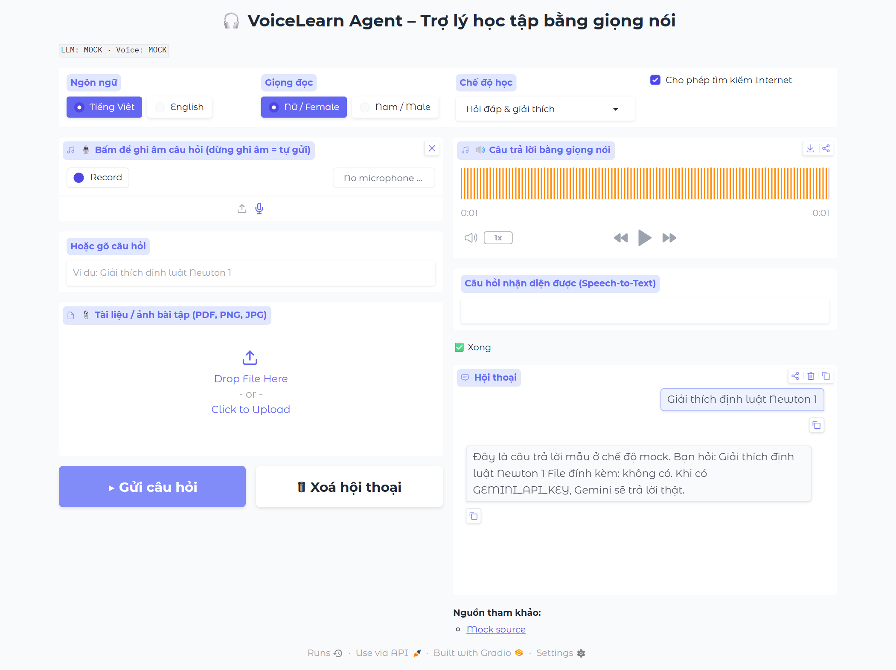
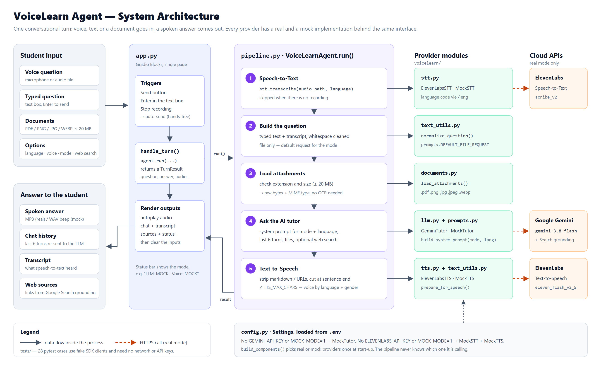
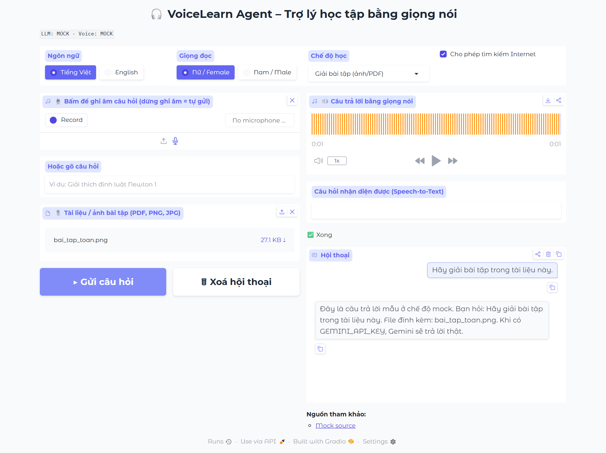
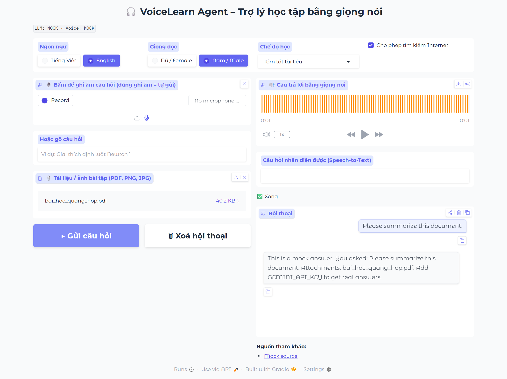

<div align="center">

# 🎧 VoiceLearn Agent

**A voice-first AI study assistant for students, designed first for blind and visually impaired learners.**

Ask a question out loud or upload a photo or PDF of your homework. The AI tutor reads it, can search the web, and **answers back in a natural voice**. It works in Vietnamese and English, with a female or male voice.




</div>

---

## Table of contents

1. [What is VoiceLearn Agent?](#what-is-voicelearn-agent)
2. [Architecture](#architecture)
3. [Project structure](#project-structure)
4. [Getting started](#getting-started)
5. [Reproducing the results](#reproducing-the-results)
6. [Using the app](#using-the-app)
7. [Configuration reference](#configuration-reference)
8. [Using the pipeline from Python](#using-the-pipeline-from-python)
9. [Customization](#customization)
10. [Troubleshooting](#troubleshooting)
11. [Known limitations and roadmap](#known-limitations-and-roadmap)

---

## What is VoiceLearn Agent?

Most study tools assume the learner can read a screen. VoiceLearn Agent is a **spoken tutor**: the student talks, the agent listens, thinks, and talks back. One conversational turn looks like this:

1. **Listen.** The student records a question. ElevenLabs **Scribe v2** turns the speech into text. Stopping the recording sends the question automatically, so the student never has to find a button.
2. **Understand.** Typed text, the transcript and any attached **PDF or image** go to **Google Gemini**. Gemini reads PDFs and images natively, so there is no OCR step.
3. **Answer.** Gemini replies as a patient tutor. With Google Search grounding turned on, the answer comes with a list of web sources.
4. **Speak.** The answer is cleaned up for listening (no markdown symbols, no URLs, cut at a sentence boundary) and read aloud with ElevenLabs **eleven_flash_v2_5** text-to-speech.

### Key features

| Feature | How it works |
|---|---|
| 🎙️ Voice questions | `gr.Audio` recorder → ElevenLabs Speech-to-Text (`scribe_v2`, Vietnamese and English). Stopping the recording sends the question. |
| 📎 Homework from a photo or PDF | Files are sent to Gemini as raw bytes with their MIME type (multimodal input, no OCR). |
| 🌐 Web-grounded answers | Gemini's **Grounding with Google Search** tool. Sources are shown under the chat. |
| 🔊 Spoken answers | ElevenLabs Text-to-Speech, with female and male voices set in `.env`. Optional native Vietnamese voices. |
| 🧑‍🏫 4 study modes | Q&A and explanation · Solve an exercise · Summarize a document · Practice quiz. Each mode has its own system prompt. |
| ♿ Written for listening | Prompts ask for short spoken sentences, formulas said in words ("x squared plus two x"), and no lists or tables. |
| 🧪 Mock mode | Runs **with no API keys**: canned answers and a short "beep" stand in for the AI and the voice. Good for teaching, demos and CI. |

---

## Architecture



<sub>Editable source: [docs/images/architecture.svg](docs/images/architecture.svg)</sub>

**How a turn flows**

- **`app.py`** is the single-page Gradio UI. Three events call `handle_turn()`: the *Send* button, pressing Enter in the text box, and *stop recording*. `handle_turn()` calls `VoiceLearnAgent.run(...)` and renders the `TurnResult`: audio, transcript, chat, sources and status.
- **`voicelearn/pipeline.py`** runs the five steps shown in the diagram. A failure in one step (for example, the speech-to-text call fails) is collected in `TurnResult.errors` and shown in the status line. It does not crash the UI.
- **Provider modules** (`stt.py`, `llm.py`, `tts.py`) each have a **real** class and a **mock** class with the same interface. `build_components()` picks one of each at start-up from `config.Settings`, so the pipeline never knows which one it is talking to.

**Real vs. mock is decided per provider**

| `.env` | LLM | Voice (STT + TTS) | Status bar |
|---|---|---|---|
| no keys | Mock | Mock | `LLM: MOCK · Voice: MOCK` |
| only `GEMINI_API_KEY` | Gemini | Mock | `LLM: Gemini (gemini-3.8-flash) · Voice: MOCK` |
| both keys | Gemini | ElevenLabs | `LLM: Gemini (gemini-3.8-flash) · Voice: ElevenLabs (scribe_v2 / eleven_flash_v2_5)` |
| `MOCK_MODE=1` | Mock | Mock | forces mock even when keys are set |

---

## Project structure

```text
VoiceLearn_Agent/
├── app.py                  # Gradio web UI (single page), entry point
├── voicelearn/             # Core package
│   ├── __init__.py         # Public API: Settings, VoiceLearnAgent, TurnResult, LANGUAGES, GENDERS, MODES
│   ├── config.py           # Reads .env; languages, voices, study modes; real vs. mock switch
│   ├── pipeline.py         # VoiceLearnAgent.run(): STT → question → attachments → LLM → TTS
│   ├── stt.py              # ElevenLabsSTT (Scribe) + MockSTT
│   ├── llm.py              # GeminiTutor (+ Google Search grounding) + MockTutor
│   ├── prompts.py          # Tutor system prompts (written to be READ ALOUD), one per mode
│   ├── documents.py        # Validates PDF/image files → bytes + MIME type
│   ├── tts.py              # ElevenLabsTTS (female/male voices) + MockTTS (WAV beep)
│   └── text_utils.py       # Normalizes questions; strips markdown and truncates text before TTS
├── tests/                  # 28 pytest cases with fake SDK clients (no network, no API keys)
├── scripts/list_voices.py  # Lists the ElevenLabs voice IDs available to your account
├── samples/                # Sample lesson PDF (photosynthesis) and a math exercise image
├── docs/images/            # Architecture diagram and UI screenshots used in this README
├── requirements.txt
└── .env.example            # Configuration template
```

---

## Getting started

### Prerequisites

| Requirement | Notes |
|---|---|
| Python **3.10+** | Tested with Python 3.12 on Windows 11. |
| A modern browser | Chrome, Edge or Firefox. Recording needs `localhost` or HTTPS. |
| Microphone + speakers | Optional. You can also type questions or upload an audio file. |
| API keys (optional) | [Gemini API key](https://aistudio.google.com/apikey) and [ElevenLabs API key](https://elevenlabs.io/app/settings/api-keys). Without them the app runs in mock mode. |

### 1. Get the code

```bash
git clone <repository-url> VoiceLearn_Agent
cd VoiceLearn_Agent
```

### 2. Create a virtual environment

```bash
python -m venv .venv

# macOS / Linux
source .venv/bin/activate
# Windows (PowerShell)
.venv\Scripts\Activate.ps1
# Windows (cmd)
.venv\Scripts\activate.bat
```

### 3. Install dependencies

```bash
pip install -r requirements.txt
```

> [!WARNING]
> **Windows users:** the `elevenlabs` package contains files with very long names. If Windows *Long Path* support is off (the default), `pip` fails with `OSError: [Errno 2] No such file or directory … HINT: … Windows Long Path support`. Fix it in one of two ways:
> - **Recommended:** enable long paths once (in an *administrator* PowerShell), then open a new terminal:
>   ```powershell
>   New-ItemProperty -Path "HKLM:\SYSTEM\CurrentControlSet\Control\FileSystem" -Name LongPathsEnabled -Value 1 -PropertyType DWORD -Force
>   ```
> - **No admin rights:** create the virtual environment at a very short path, e.g. `python -m venv C:\vlv`, and activate that one instead.

### 4. Configure (optional)

```bash
cp .env.example .env        # Windows: copy .env.example .env
```

Open `.env` and fill in `GEMINI_API_KEY` and/or `ELEVENLABS_API_KEY`. **Leave them empty to stay in mock mode.** All options are listed in the [Configuration reference](#configuration-reference).

### 5. Run the app

```bash
python app.py
```

Open **http://127.0.0.1:7860**. The status bar under the title shows which providers are real and which are mocked.

---

## Reproducing the results

The steps below reproduce everything shown in this README. Steps A and B need **no API keys and no network** (besides `pip install`).

### A. Run the test suite

```bash
pytest -q
```

Expected output:

```text
............................                                             [100%]
28 passed in ~10s
```

The tests replace the Gemini and ElevenLabs SDK clients with fakes that have the same shape as the real API. They check the parameters sent on each call (model, voice ID, language code, Google Search tool, history trimming) and cover the UI handler, the document loader, the pipeline and the text clean-up.

| Test file | What it covers |
|---|---|
| `tests/test_pipeline.py` | Full turns: voice question, text + voice combined, file-only default request, empty input, history trimming, `speak=False`, LLM errors, prompt per mode and language |
| `tests/test_providers.py` | Gemini request (history, files, search tool on/off, error wrapping); STT model and language code; TTS voice selection, including native Vietnamese voices |
| `tests/test_documents.py` | PDF and image loading, bad extensions, size limit, empty input |
| `tests/test_text_utils.py` | Question normalization, markdown and URL stripping, sentence-boundary truncation |
| `tests/test_app.py` | The Gradio UI builds; `handle_turn()` works end to end in mock mode |

### B. Demo scenarios in mock mode

Start the app with no keys in `.env` (or with `MOCK_MODE=1`) and run these three scenarios. Your screen should match the screenshots.

<table>
<tr>
<th width="33%">1 · Typed Q&amp;A (Vietnamese)</th>
<th width="33%">2 · Solve an exercise from an image</th>
<th width="33%">3 · Summarize a PDF (English, male voice)</th>
</tr>
<tr>
<td><a href="docs/images/ui_qa.png"></a></td>
<td><a href="docs/images/ui_solve_image.png"></a></td>
<td><a href="docs/images/ui_summary_pdf_en.png"></a></td>
</tr>
<tr>
<td>Type <code>Giải thích định luật Newton 1</code> in <i>Hoặc gõ câu hỏi</i> and press Enter.</td>
<td>Set <i>Chế độ học</i> to <b>Giải bài tập (ảnh/PDF)</b>, upload <code>samples/bai_tap_toan.png</code>, click <b>▶ Gửi câu hỏi</b>.</td>
<td>Choose <b>English</b> and <b>Nam / Male</b>, set the mode to <b>Tóm tắt tài liệu</b>, upload <code>samples/bai_hoc_quang_hop.pdf</code>, click Send.</td>
</tr>
<tr>
<td><b>Expected:</b> a mock answer that repeats your question, a short beep in the audio player, and <i>Mock source</i> under the chat.</td>
<td><b>Expected:</b> with no question typed, the agent asks <i>"Hãy giải bài tập trong tài liệu này."</i> by itself. The answer lists <code>bai_tap_toan.png</code> as the attachment.</td>
<td><b>Expected:</b> the default request is <i>"Please summarize this document."</i> and the mock answer is in English. The beep is lower-pitched (220 Hz male vs. 440 Hz female).</td>
</tr>
</table>

To test the voice path offline, click the upload icon in the recorder and pick any audio file. Mock speech-to-text returns a fixed sample question, *"Quang hợp là gì và diễn ra ở đâu trong cây?"* in Vietnamese or *"What is photosynthesis and where does it happen in a plant?"* in English.

Generated audio files are written to `outputs/` (git-ignored).

### C. Real mode (with API keys)

1. Put both keys in `.env` and restart `python app.py`. The status bar should read
   `LLM: Gemini (gemini-3.8-flash) · Voice: ElevenLabs (scribe_v2 / eleven_flash_v2_5)`.
2. (Optional) choose voices:
   ```bash
   python scripts/list_voices.py            # all voices on your account
   python scripts/list_voices.py vietnam    # filter by keyword
   ```
   Copy a `VOICE_ID` into `VOICE_FEMALE_ID` / `VOICE_MALE_ID`. For native Vietnamese voices, add voices from the ElevenLabs Voice Library to your account and set `VOICE_VI_FEMALE_ID` / `VOICE_VI_MALE_ID`.
3. Re-run scenarios 1–3 above. You now get real tutor answers read aloud, with real web sources when *Cho phép tìm kiếm Internet* (allow web search) is checked.

> Real answers depend on the model version and on live search results, so they change from run to run. Steps A and B are fully deterministic.

---

## Using the app

The interface text is in Vietnamese, the language of the target learners. This table maps each control to English:

| UI label | Meaning | Values |
|---|---|---|
| **Ngôn ngữ** | Answer language (also the speech-to-text language) | Tiếng Việt · English |
| **Giọng đọc** | Voice | Nữ / Female · Nam / Male |
| **Chế độ học** | Study mode | see below |
| **Cho phép tìm kiếm Internet** | Allow Google Search grounding | on / off |
| **Bấm để ghi âm câu hỏi (dừng ghi âm = tự gửi)** | Record a question; stopping sends it | microphone or audio upload |
| **Hoặc gõ câu hỏi** | Or type a question (Enter sends) | text |
| **Tài liệu / ảnh bài tập** | Documents / exercise images | PDF, PNG, JPG, JPEG, WEBP (several allowed) |
| **Gửi câu hỏi** / **Xoá hội thoại** | Send / Clear conversation | buttons |
| **Câu trả lời bằng giọng nói** | Spoken answer (autoplays) | audio |
| **Câu hỏi nhận diện được** | Speech-to-text transcript | text |
| **Hội thoại** / **Nguồn tham khảo** | Conversation / Sources | chat, links |

### Study modes

| Mode (key) | UI label | Tutor behavior |
|---|---|---|
| `qa` | Hỏi đáp & giải thích | Explains step by step with one everyday example, then asks one check-for-understanding question. |
| `solve` | Giải bài tập (ảnh/PDF) | Reads the exercise aloud briefly, solves it step by step, and states the final answer clearly. |
| `summary` | Tóm tắt tài liệu | One sentence on what the document is about, the 3–5 key ideas, and one sentence to remember. |
| `quiz` | Luyện tập (đố vui) | Asks one question at a time (A/B/C or short answer), grades each reply, and keeps score. |

If you send only a file without a question, the agent uses a default request for the selected mode (for example *"Please summarize this document."*).

---

## Configuration reference

All settings are read from `.env` by `voicelearn/config.py`.

| Variable | Default | Description |
|---|---|---|
| `GEMINI_API_KEY` | *(empty)* | Gemini API key (`GOOGLE_API_KEY` also works). Empty → mock LLM. |
| `ELEVENLABS_API_KEY` | *(empty)* | ElevenLabs API key. Empty → mock STT and TTS. |
| `MOCK_MODE` | `0` | `1` / `true` / `yes` forces mock mode even when keys are set. |
| `GEMINI_MODEL` | `gemini-3.8-flash` | Gemini model ID. Cheaper option: `gemini-3.5-flash-lite`. |
| `ELEVENLABS_STT_MODEL` | `scribe_v2` | Speech-to-text model (supports Vietnamese). |
| `ELEVENLABS_TTS_MODEL` | `eleven_flash_v2_5` | Text-to-speech model. `eleven_v3` sounds more natural but is slower and costs more. **Do not** use `eleven_multilingual_v2`: it has no Vietnamese. |
| `VOICE_FEMALE_ID` | `XrExE9yKIg1WjnnlVkGX` | Default female voice. |
| `VOICE_MALE_ID` | `JBFqnCBsd6RMkjVDRZzb` | Default male voice. |
| `VOICE_VI_FEMALE_ID` / `VOICE_VI_MALE_ID` | *(empty)* | Optional native Vietnamese voices. Used instead of the defaults when the language is Vietnamese. |
| `TTS_MAX_CHARS` | `1500` | Maximum characters read aloud per answer (saves TTS credits). Text is cut at a sentence boundary. |

Fixed in code (`Settings`): `history_turns = 6` (turns re-sent to the LLM), `max_file_mb = 20`, `output_dir = outputs/`.
Gradio's own variables also work, e.g. `GRADIO_SERVER_PORT=7861` or `GRADIO_SERVER_NAME=0.0.0.0`.

---

## Using the pipeline from Python

The UI is a thin layer: you can call the agent directly from a script or a notebook.

```python
from voicelearn import Settings, VoiceLearnAgent

agent = VoiceLearnAgent(Settings())          # mock mode when no API keys are set
result = agent.run(
    text="Solve this exercise step by step",
    files=["samples/bai_tap_toan.png"],
    mode="solve", language="en", gender="male", use_search=False,
)
print(result.answer)       # tutor answer (text)
print(result.audio_path)   # outputs/answer_xxxx.mp3 (real) or outputs/mock_xxxx.wav (mock)
print(result.sources)      # [{"title": ..., "url": ...}] when web search is used
print(result.errors)       # [] if every step succeeded
```

`run()` also accepts `audio_path=` (a recorded question), `history=` (Gradio-style `[{"role": ..., "content": ...}]` messages) and `speak=False` to skip text-to-speech. You can inject your own `stt`, `tts` or `tutor` objects in `VoiceLearnAgent(settings, stt=..., tts=..., tutor=...)`, as the tests do.

---

## Customization

| I want to… | Change |
|---|---|
| Use a different Gemini model | `GEMINI_MODEL` in `.env` |
| Get a more natural voice | `ELEVENLABS_TTS_MODEL=eleven_v3` |
| Get shorter or longer answers | `max_words` in `prompts.build_system_prompt()` and `TTS_MAX_CHARS` in `.env` |
| Add a study mode | Add a key to `MODES` (`config.py`), `MODE_PROMPTS` and `DEFAULT_FILE_REQUEST` (`prompts.py`) |
| Add a language | Add an entry to `LANGUAGES` in `config.py` with its STT code (ISO 639-3) and TTS code (ISO 639-1) |
| Swap a provider (e.g. Whisper STT) | Write a class with the same method (`transcribe` / `ask` / `synthesize`) and pass it to `VoiceLearnAgent(...)` |
| Share the demo with another device | `build_ui().launch(share=True)` in `app.py` (gives an HTTPS link, which recording needs) |

---

## Troubleshooting

| Symptom | Cause / fix |
|---|---|
| `pip install` fails with `Windows Long Path support` | See the warning in [step 3](#3-install-dependencies). |
| Recorder shows **"No microphone"** or recording is blocked | The browser only allows the microphone on `localhost` or HTTPS. Use `http://127.0.0.1:7860` locally, or `share=True` from another device. You can still upload an audio file. |
| Status bar shows `MOCK` although keys are set | Check that the file is named `.env` (not `.env.txt`), sits in the project root, and that `MOCK_MODE=0`. Restart the app after editing it. |
| `Gemini lỗi: …` in the status line | Invalid key, quota exceeded or network error. The message after the colon is the SDK error. |
| `Gemini không trả về nội dung` | The answer was blocked by safety filters. Rephrase the question. |
| Vietnamese answers sound like English | Use `eleven_flash_v2_5` or `eleven_v3`, not `eleven_multilingual_v2`, or set native `VOICE_VI_*_ID` voices. |
| `File … nặng … MB, vượt giới hạn 20 MB` | Files are sent inline. Split the PDF or compress the image. |
| Port 7860 already in use | `GRADIO_SERVER_PORT=7861 python app.py` |

---

## Known limitations and roadmap

**Limitations of the current version**

- Files are sent **inline** to Gemini, with a 20 MB limit per file. Long documents should use the Gemini Files API.
- Conversation history lives only in the browser session (the last 6 turns go to the LLM). Nothing is stored in a database.
- Answers are spoken only after the full reply is generated. There is no streaming TTS yet.
- The app uses `generate_content`, which Google labels "legacy" next to the newer Interactions API. It is still supported and is the most widely documented call.

**Roadmap (not yet implemented)**

- Retrieval-Augmented Generation (RAG) over a library of course materials with a vector store (FAISS / ChromaDB).
- Learner progress tracking and suggestions for weak topics.
- Full keyboard-shortcut and screen-reader pass on the UI; a mobile app.

---

<div align="center">
<sub>Built with Gradio · Google Gemini · ElevenLabs</sub>
</div>
